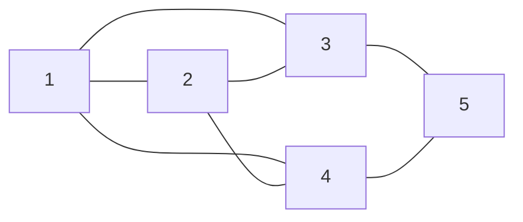
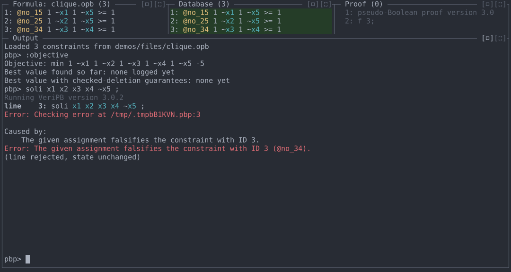
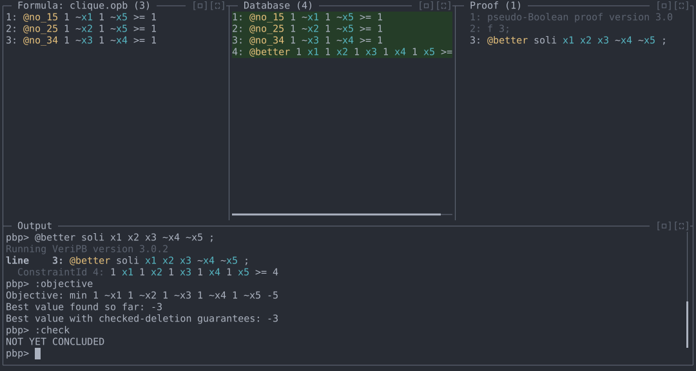
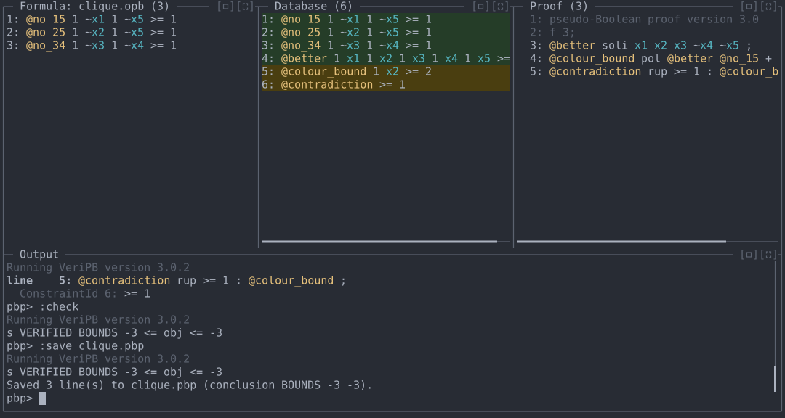

# Demo 4: Proving a maximum clique optimal

Log a solution to an optimisation problem, then prove no better solution
exists, and certify the optimal value. The REPL tracks the best solution
logged so far and finds the bound the proof establishes.

**Files:** [`files/clique.opb`](files/clique.opb)
**Run from:** the repository root, with `veripb` configured as in
[README.md](../README.md).

## The problem

Find a largest clique (a set of pairwise adjacent vertices) in this
graph:



Variable `xi` means vertex `i` is in the clique. A clique can't contain
both ends of a non-edge, so the formula has one constraint per non-edge
(1–5, 2–5, 3–4). Maximising the clique size is minimising
`-x1 - x2 - x3 - x4 - x5`:

```
* #variable= 5 #constraint= 3
min: -1 x1 -1 x2 -1 x3 -1 x4 -1 x5 ;
@no_15 1 ~x1 1 ~x5 >= 1 ;
@no_25 1 ~x2 1 ~x5 >= 1 ;
@no_34 1 ~x3 1 ~x4 >= 1 ;
```

The largest cliques have three vertices, e.g. `{1, 2, 3}`. To prove
there is none with four, split the vertices into independent sets
`{1, 5}`, `{3, 4}` and `{2}`: a clique has at most one vertex from each,
so at most three in total.

## 1. Look at the objective, and try a clique that is too big

```
cargo run -- demos/files/clique.opb
```

```
:objective
soli x1 x2 x3 x4 ~x5 ;
```

`:objective` shows the objective in normalised form
(`-xi = ~xi - 1`, so `1 ~x1 … 1 ~x5 -5`) and that no solution has been
logged yet. `soli` logs a solution, here `{1, 2, 3, 4}`. It is rejected:
the assignment falsifies constraint 3, which the REPL names as `@no_34`,
since vertices 3 and 4 are not adjacent.

The screenshot below has the Output pane enlarged with its `[▭]` button.



## 2. Log a three-vertex clique

```
@better soli x1 x2 x3 ~x4 ~x5 ;
:objective
:check
```

`soli` checks the solution `{1, 2, 3}` and adds a constraint that every
better solution must satisfy: objective at most `-4`, i.e.
`1 x1 1 x2 1 x3 1 x4 1 x5 >= 4`, labelled `@better` here. `:objective`
now reports the best value `-3`. `:check` reports `NOT YET CONCLUDED`:
nothing yet shows that `-3` is optimal.



## 3. Prove there is no better clique

```
@colour_bound pol @better @no_15 + @no_34 + ;
@contradiction rup >= 1 : @colour_bound ;
```

Adding the two non-edge constraints to `@better` cancels `x1, x3, x4, x5`
and leaves `1 x2 >= 2`, which no assignment satisfies, so `rup` derives
the contradiction from it. No clique has four vertices.

## 4. Certify the optimum

```
:check
:save clique.pbp
```

With no argument, `:check` also tries `BOUNDS v v` for the best value
logged, and reports `s VERIFIED BOUNDS -3 <= obj <= -3`: the maximum
clique has exactly three vertices. `:save` writes the proof with that
conclusion.



`clique.pbp` is accepted by `veripb` on its own:

```
pseudo-Boolean proof version 3.0
f 3;
@better soli x1 x2 x3 ~x4 ~x5 ;
@colour_bound pol @better @no_15 + @no_34 + ;
@contradiction rup >= 1 : @colour_bound ;
output NONE;
conclusion BOUNDS -3 -3;
end pseudo-Boolean proof;
```

## Commands used

| Command | Purpose |
|---|---|
| `:objective` | Show the objective and the best values logged. |
| `soli <literal> ... ;` | Log a solution and require any later one to be better. |
| `:check` | Test for a conclusion, including `BOUNDS` for the best value logged. |
| `:save <file>` | Write the proof with its conclusion. |
